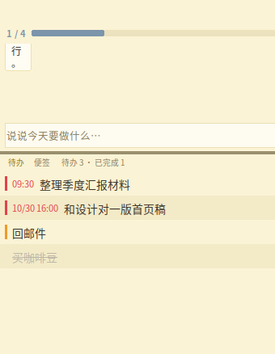
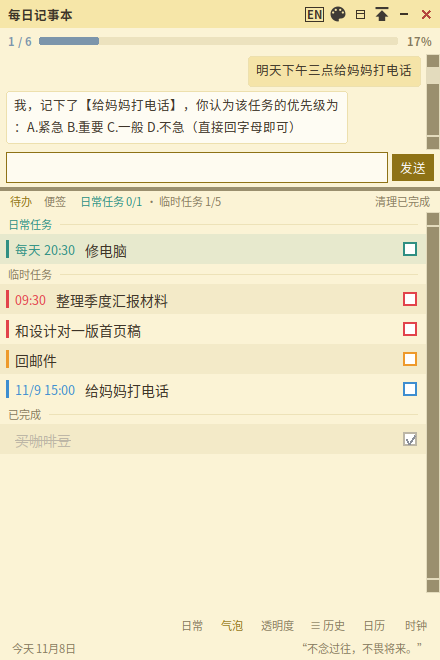
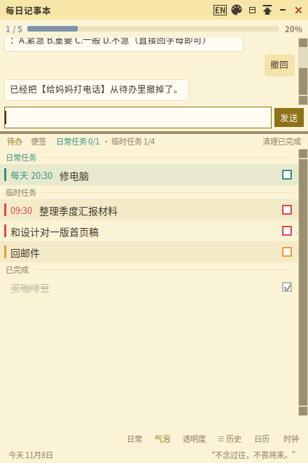
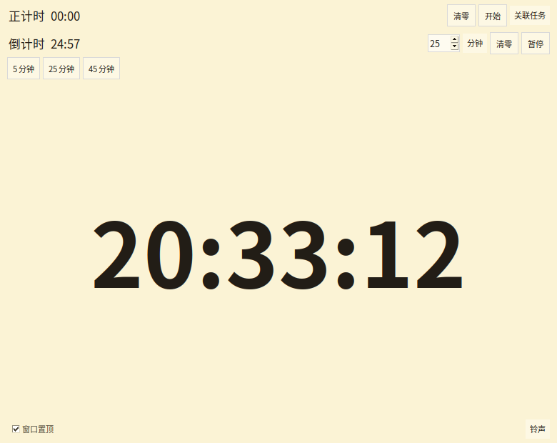
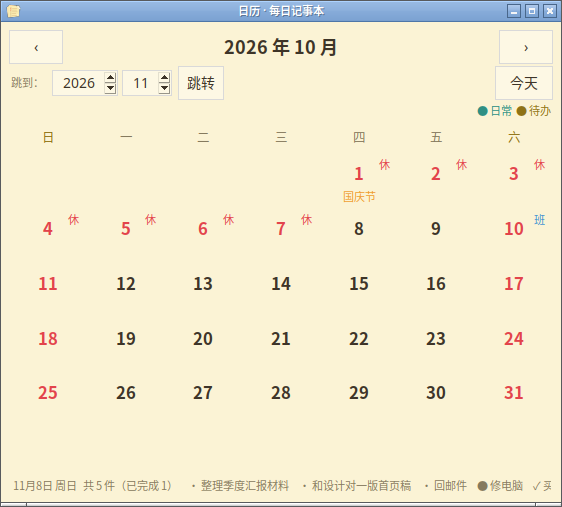
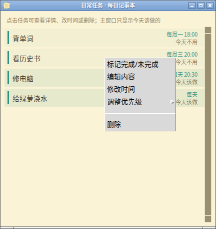
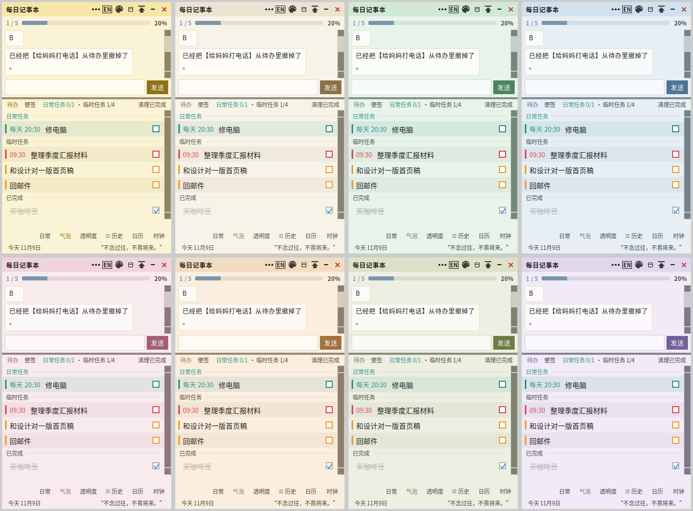
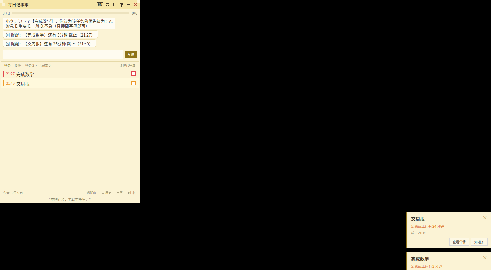
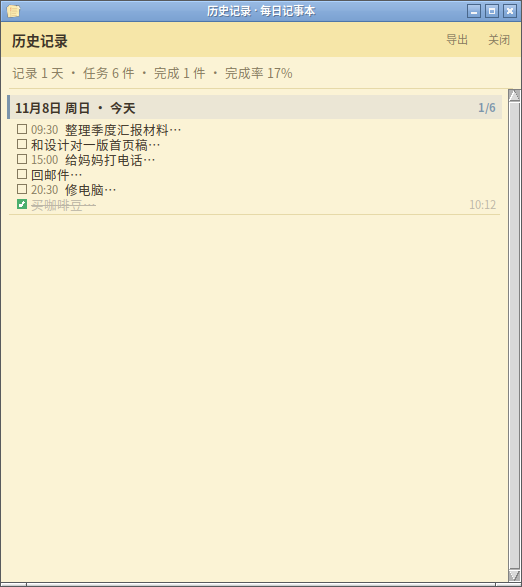
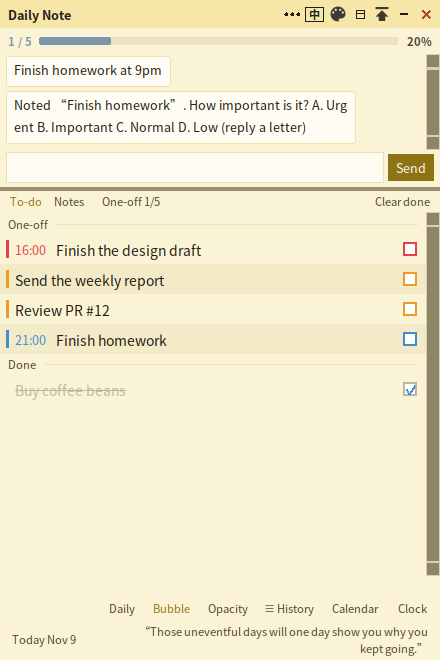

# 每日记事本 · Daily Notebook

> 一款「像聊天一样记待办」的 Windows 桌面小程序。用中文自然语言说话，它帮你拆任务、认时间、排优先级、到点提醒。

纯 Python + Tkinter 实现，零第三方依赖，免安装、完全离线，可打包成单文件 exe。

## 下载

**[⬇ 下载 Windows 免安装版](../../releases/latest)**

下载后双击 `DailyNotebook.exe` 即可，**无需安装 Python、无需命令行**。

> 嫌每次找链接麻烦？也可以直接运行源码（见下方「运行」）。
> 首次运行会自动在桌面和程序目录创建带图标的快捷方式。



---

## 特性

- **聊天式建任务**：输入「明天下午三点前交数学报告」，自动识别截止时间、拆分多条任务、按重要性排序（A 紧急 / B 重要 / C 一般 / D 不急）。
- **口语时间识别**：「三点二十分」「八点半」「十一点一刻」「前一晚21点」都能懂；没说上午下午时按语境推断（下午说「三点」= 15:00）。
- **到点提醒**：可设提前 5/15/30/60 分钟，或指定具体时刻；到点弹窗 + 铃声，右下角悬浮卡片可拖动。
- **过期询问**：截止时间已过的任务不会静默加入，先问「还要不要」，避免脏数据。
- **撤回机制**：说「撤回」撤销上一步——建错任务、设错截止时间、设错提醒时刻都能撤，撤完可直接重新输入。
- **日常任务**：每天 / 每周循环任务（「每天修电脑」「每周一背单词」）单独收纳在管理窗里，主窗口只显示今天该做的，支持右键改时间、调优先级。
- **待办栏**：右键改名 / 调优先级 / 删除；双击标题内联编辑；勾选完成自动划线下沉；顶部进度条一目了然。
- **时钟工具**：秒表 + 倒计时（设定档位 → 开始 → 暂停 → 继续 → 清零）+ 日历（按天回看记录，含节假日）。
- **透明度 / 置顶 / 便签**：窗口可半透明、可置顶、可拖动缩放。
- **历史归档**：每天任务自动归档，不限制保留天数，随时回看做了什么。
- **中英双语**：一键切换，界面文案、哲言、任务解析全适配。
- **八套主题**：随心情换配色。

## 界面一览

### 主窗口（聊天区 + 待办栏）

| 主界面 | 聊天问答建任务 | 撤回指令 |
|---|---|---|
|  |  |  |
| **主界面**：上半是聊天区，下半是待办栏；顶部进度条只统计今天的任务，底部「日常任务 / 临时任务」双色计数，勾选完成自动划线下沉 | **聊天问答建任务**：说「明天下午三点给妈妈打电话」，自动认出时间并追问优先级（A 紧急 / B 重要 / C 一般 / D 不急），确认后入列 | **撤回指令**：说「撤回」撤销上一步——刚建的任务立即从列表消失，建错时间、设错提醒也都能撤 |

### 独立工具窗口

| 时钟 | 日历 | 日常任务管理窗 |
|---|---|---|
|  |  |  |
| **时钟**（独立窗口）：正计时秒表 + 倒计时（5/25/45 分钟快捷档），可关联某个任务专心计时；窗口置顶、铃声可换 | **日历**（独立窗口）：按天回看每天做了什么，法定节假日带「休 / 班」角标，可快速跳转任意日期 | **日常任务管理窗**（独立窗口）：所有每天 / 每周的循环任务集中在这里；右键可改时间、调优先级、编辑、删除；主窗口只显示「今天该做的」，不会天天刷屏 |

### 更多

| 八套主题 | 右下角截止提醒 | 历史记录 | 英文界面 |
|---|---|---|---|
|  |  |  |  |
| **八套主题**：奶油黄 / 米白 / 薄荷 / 雾蓝 / 藕粉 / 浅杏 / 鼠尾草 / 淡紫，一键换配色 | **右下角截止提醒**：屏幕角落悬浮卡片实时显示未完成任务数，点开逐条查看，点任务名直达详情 | **历史记录**（独立窗口）：每天的任务自动归档，不限保留天数，随时回看 | **英文界面**：中英一键切换，界面文案、小技巧、任务解析（undo / every monday 等）全部适配 |

---

## 运行

**方式一：免安装 exe（推荐，Windows）**

从上方「下载」处拿到 `DailyNotebook.exe`，双击即用。不需要 Python，不需要命令行。

**方式二：从源码运行**

需要 Python 3.10+（Tkinter 随 Python 自带，安装时记得勾选 **Add python.exe to PATH**）。

```bash
python main.py
```

或直接双击 **`启动.bat`** —— 首次启动会自动在桌面和程序目录创建带图标的快捷方式。
若快捷方式图标显示为旧的，双击 **`修复图标.bat`** 一键重建并刷新缓存。

**方式三：自己打包 exe（Windows）**

双击 **`打包.bat`**，产物在 `dist/DailyNotebook.exe`，免安装、单文件、完全离线。

---

## 数据存储

数据全部保存在程序同目录的 `data/` 下，纯本地、不上传任何服务器：

| 文件 | 内容 |
|---|---|
| `data/tasks.json` | 当日任务与聊天记录 |
| `data/history.json` | 每日历史归档 |
| `data/settings.json` | 主题、透明度、昵称、助手名等设置 |

换电脑时把整个文件夹拷走即可。

---

## 项目结构

```
每日记事本/
├── main.py            # 主程序：UI、对话流程、状态机（约 9800 行）
├── parser.py          # 中文自然语言解析：时间 / 日期 / 时长 / 优先级 / 重复
├── parser_en.py       # 英文解析器
├── i18n.py            # 中英双语文案表
├── themes.py          # 主题配色
├── quotes.py          # 底部哲言库
├── holidays.py        # 节假日数据（日历用）
├── assets/            # 图标（ico / png）
├── tests/             # pytest 自动化测试（487 个用例）
├── 使用说明.md         # 完整使用手册 + 逐版本更新日志
├── 打包.bat           # Windows 一键打包脚本
└── 每日记事本.spec     # PyInstaller 配置
```

---

## 测试

```bash
pip install pytest
pytest tests/ -q
```

487 个用例，覆盖解析准确率、对话流程、跨天归档、中英切换、撤回语义、GUI 交互、打包配置等。

---

## 许可

个人项目，欢迎 issue 交流。
